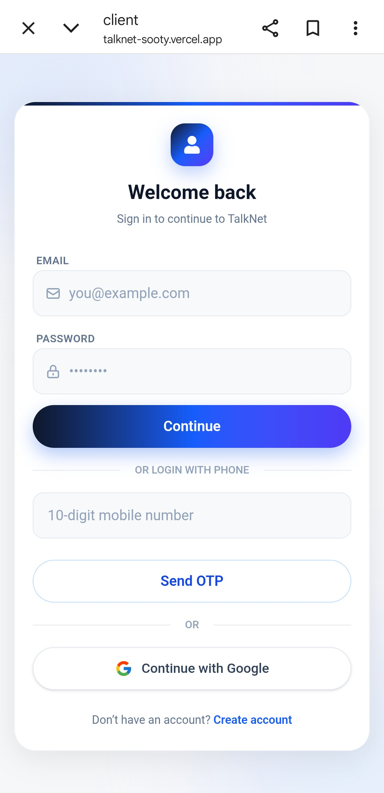
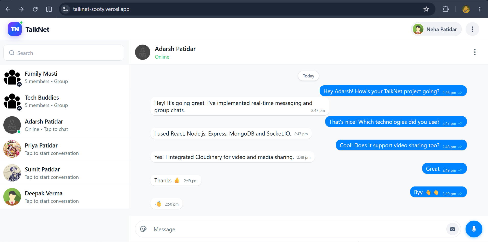
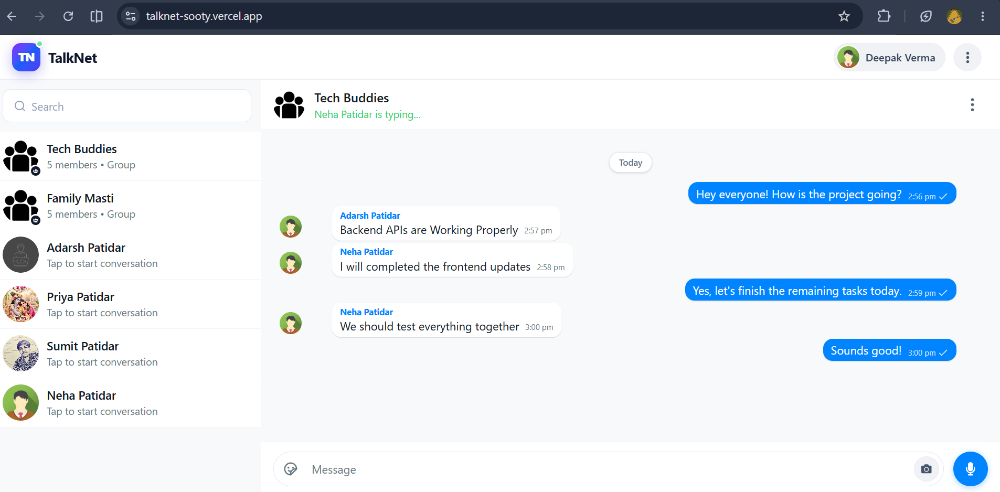
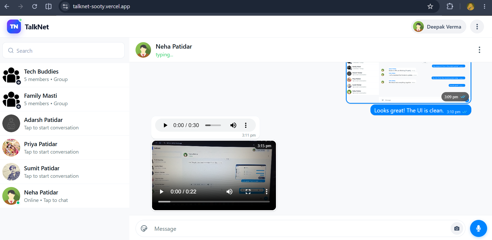
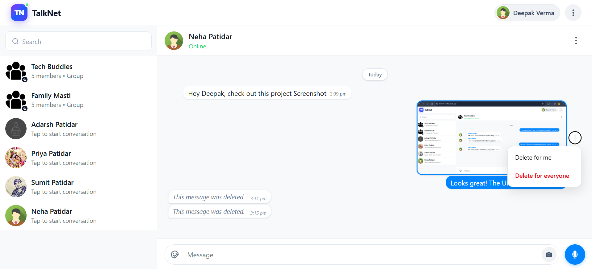
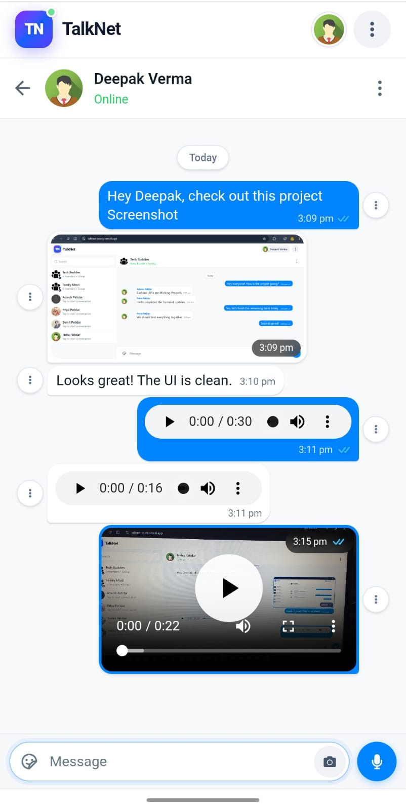

# TalkNet – Real-Time Chat Application

TalkNet is a full-stack real-time chat application built using the MERN stack. It enables users to communicate through private conversations and group chats, with real-time updates and media sharing.

**Live Demo:** https://talknet-sooty.vercel.app/

## Features

- **Authentication:** Secure JWT-based authentication and Google Sign-In.
- **Phone Authentication:** Firebase Phone Authentication integration with test-number verification.
- **Private Chat:** Real-time one-to-one messaging.
- **Group Chat:** Create and manage group conversations.
- **Real-Time Communication:** Instant messaging powered by Socket.IO.
- **Online Status:** View users' online/offline status and last seen.
- **Typing Indicator:** See when another user is typing.
- **Message Management:** Delete messages for yourself or everyone.
- **Media Sharing:** Share images and other supported media using Cloudinary.
- **Message Pagination:** Load messages efficiently in conversations.
- **Group Administration:** Group admin controls and admin transfer.
- **Responsive Design:** Interface adapted for desktop and mobile devices.

## Tech Stack

**Frontend**
- React.js
- Vite
- Redux Toolkit
- Tailwind CSS
- Axios
- Socket.IO Client
- Firebase Authentication

**Backend**
- Node.js
- Express.js
- MongoDB
- Mongoose
- Socket.IO
- JSON Web Token (JWT)
- Firebase Admin SDK
- Cloudinary

## Project Structure

```text
TalkNet/
├── client/       # React frontend
├── server/       # Node.js and Express backend
└── README.md
```

## Getting Started

Follow these steps to run TalkNet locally.

### Prerequisites

- Node.js and npm
- MongoDB database (local or MongoDB Atlas)
- Firebase project
- Cloudinary account

### 1. Clone the Repository

```bash
git clone https://github.com/adarshpatidar99/TalkNet.git
cd TalkNet
```

### 2. Set Up the Backend

```bash
cd server
npm install
```

Create a `.env` file inside the `server` folder:

```env
PORT=5000
MONGO_URI=your_mongodb_connection_string
JWT_SECRET=your_jwt_secret
JWT_EXPIRE=10d
COOKIE_EXPIRE=15
FRONTEND_URL=http://localhost:5173

CLOUDINARY_CLOUD_NAME=your_cloudinary_cloud_name
CLOUDINARY_API_KEY=your_cloudinary_api_key
CLOUDINARY_API_SECRET=your_cloudinary_api_secret

NODE_ENV=development
FIREBASE_SERVICE_ACCOUNT_PATH=path_to_your_firebase_service_account_file
```

Configure your MongoDB, JWT, Cloudinary, and Firebase Admin credentials. Place your Firebase service account JSON file at the configured path.

Start the backend:

```bash
npm run dev
```

### 3. Set Up the Frontend

Open a new terminal:

```bash
cd client
npm install
```

Create a `.env` file inside the `client` folder:

```env
VITE_API_URL=http://localhost:5000
```

Configure the Firebase client authentication settings for your own Firebase project.

Start the frontend:

```bash
npm run dev
```

Open the local URL shown by Vite in your browser (usually `http://localhost:5173`).

## Security Note

Never commit `.env` files, Firebase service account JSON files, API keys, database credentials, or other private secrets to GitHub.

## Author

Developed as a full-stack web development project.

**GitHub:** https://github.com/adarshpatidar99

## Screenshots

### Login


### Private One-to-One Chat


### Group Chat


### Media Sharing


### Message Deletion


### Mobile Interface

